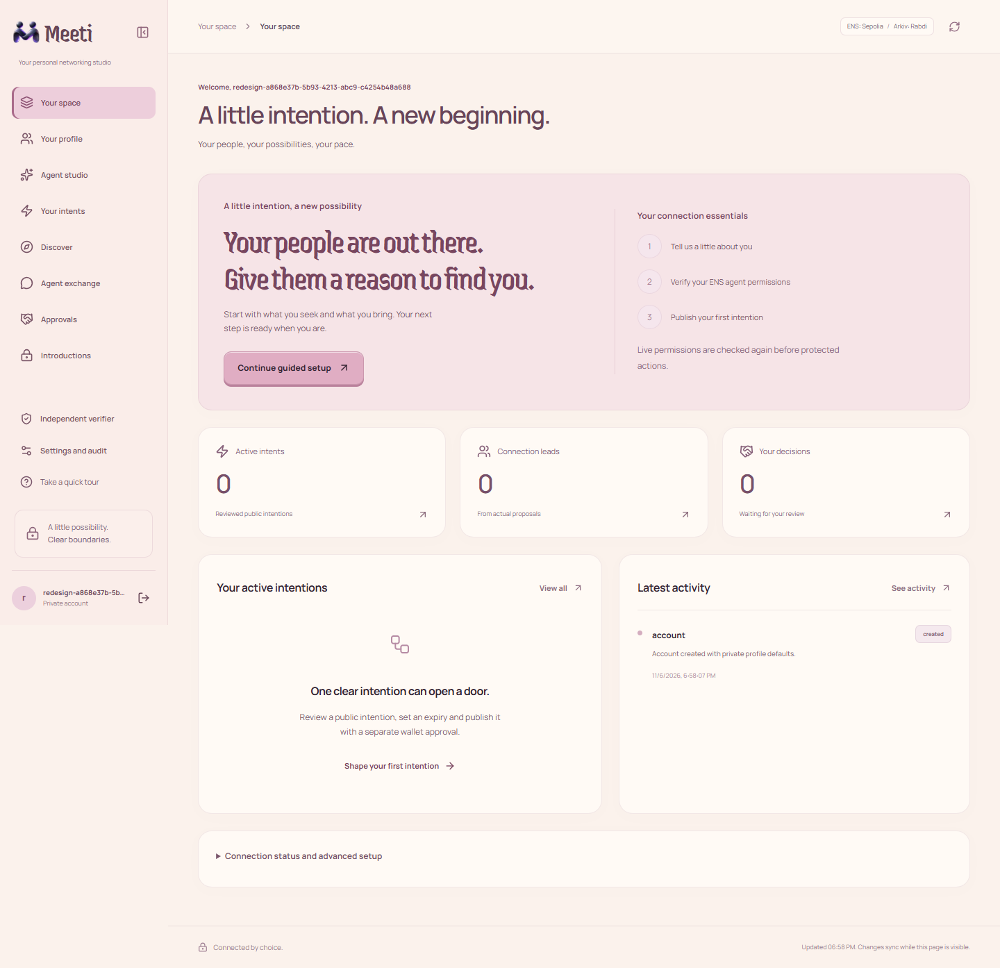
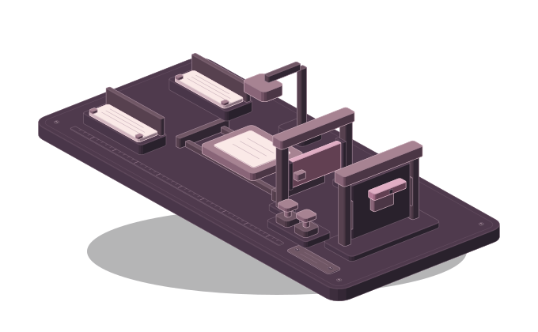

# Meeti

### Good connections begin with a little intent.

**Your agent explores. You choose who gets to meet you.**

[Open Meeti](https://meeti-theta.vercel.app) | Hosted acceptance testing in progress

[What it does](#what-it-does) · [How it works](#how-it-works) · [Get started](#get-started) · [Try the demo](#try-the-demo) · [Current status](#current-status) · [Deployment](#deployment)

---

## What it does

Meeti turns your reviewed networking goal into a discoverable intent. Your representative can find relevant people, discuss permitted public context and propose an introduction. A candidate is a suggestion. It is never consent.

<table>
<tr>
<td width="50%">

### Start with what matters

Describe the role, help or collaboration you need. Review the interpretation and choose exactly what becomes public.

</td>
<td width="50%">

### Find complementary intentions

Real Arkiv records supply candidates. Actual embeddings compare subjects and roles. Separate checks enforce direction, requirements and permissions.

</td>
</tr>
<tr>
<td>

### Give your agent clear boundaries

ENSv2 names and dedicated resolvers carry current authorization. Narrow delegation, expiry and revocation constrain actions independently of the model.

</td>
<td>

### Keep the final decision

Both people review the proposal. Private contact stays hidden until every required release gate passes. World is paused, so protected rooms stay locked.

</td>
</tr>
</table>

> **Development MVP:** real ENSv2 authorization, Arkiv publication and discovery, local embeddings, model-generated dialogue and contact denial have live evidence. World application and sandbox login returned HTTP 403. Automated fictional-account approvals do not establish independent human verification.

<strong>See the current workspace</strong>

This is the current local interface captured with an isolated fictional test account. The guide now uses an original dimensional robot drawn with shaded SVG using Anatomy guidance. Its pointing motion stops offscreen, in hidden tabs and under reduced motion. The empty state does not claim live discovery or verified identity. World is paused and no private room has opened.

## How it works

The instrument is an illustration, not live activity. Its controls explain the workflow and cannot approve an introduction.

~~~mermaid
flowchart LR
    U["You Goal and visibility"] --> I["Review public intent"]
    I --> E{"Current ENSv2 permission"}
    E -->|Allowed| A["Arkiv Rabdi Signed expiring record"]
    A --> D["Bounded candidate retrieval"]
    D --> M["Actual embeddings Bilateral requirements"]
    M --> C["AI agents Evidence-backed clarification"]
    C --> P["Candidate introduction"]
    P --> H{"Both people approve"}
    H --> W{"Fresh World verification Currently paused"}
    W -->|All gates pass| R["Private room"]
    E -->|Denied or unknown| B["Block and explain"]
    classDef plum fill:#342432,stroke:#BFAEBC,color:#FAE9E7;
    classDef cream fill:#FFF9F5,stroke:#B17690,color:#342432;
    class U,I,A,D,M,C,P,R cream;
    class E,H,W,B plum;
~~~

**AI proposes. Current permissions decide what is allowed.** Private conversations, contacts, employer details, secrets and embedding vectors stay off public discovery records.

## Get started

### 1. Install the prerequisites

The commands below use Windows PowerShell. Keep the project on a writable local drive.

| Tool | Required action | Check in a new terminal |
|---|---|---|
| Git | Install from [git-scm.com](https://git-scm.com/downloads), then reopen the terminal | git --version |
| Node.js | Install Node.js 24 or a compatible newer release from [nodejs.org](https://nodejs.org/en/download); npm is included | node --version and npm --version |
| Ollama | Install from [ollama.com](https://ollama.com/download), launch the application and keep it running for local embeddings | ollama --version |
| Browser | Use a current browser; install MetaMask from its [official download page](https://metamask.io/download/) for wallet actions | Unlock the wallet yourself when needed |

If PowerShell blocks npm.ps1, use npm.cmd in place of npm in the commands below. A global execution-policy change is not required. Never enter a recovery phrase, wallet password or private key into Meeti or its terminal.

### 2. Clone the source and install dependencies

Choose the parent directory yourself, then run:

~~~powershell
git clone https://github.com/DarshanKrishna-DK/Meeti.git
cd Meeti
node --version
npm --version
npm ci
~~~

The remaining commands must run inside the folder containing package.json. If you already have this checkout, use it and preserve your local changes instead of cloning over it. npm ci uses package-lock.json; no separate frontend or backend install is needed.

### 3. Create local configuration and private storage

~~~powershell
npm run setup
~~~

Setup creates .env.local from [.env.example](.env.example) only when missing, generates a random DATA_ENCRYPTION_KEY and creates .local-data. Open .env.local in your editor. Do not replace the generated key with the blank example, and do not regenerate a key for an existing encrypted database. Back up the database and key together in private storage. No provider credentials are installed by this command.

### 4. Configure real services

| Service | Required configuration | Boundary |
|---|---|---|
| Private persistence | DATABASE_PROVIDER, DATABASE_PATH or SUPABASE_DATABASE_URL, SUPABASE_DATABASE_CA, DATA_ENCRYPTION_KEY | SQLite locally or private Postgres for hosting; preserve the matching encryption key |
| Application | APP_ORIGIN | Exact canonical browser origin, initially http://127.0.0.1:3173 |
| ENSv2 | ENS_SEPOLIA_RPC_URL, optional ENS_SEPOLIA_AUTH_RPC_URL | Sepolia 11155111; actual names, dedicated resolvers and current grants |
| Arkiv | ARKIV_ACCESS_KEY | Rabdi 7794095; SDK builds its keyed RPC URL; publishing wallet needs test GLM |
| Agent reasoning | AI_BASE_URL, AI_API_KEY, AI_MODEL, response format and budget settings | Server-side provider with actual structured calls and source validation |
| Embeddings | EMBEDDING_* plus MATCHING_MIN_COSINE, MATCHING_CALIBRATED_REVISION and MATCHING_CALIBRATED_FORMAT | Exact model revision and dimensions; calibration must match |
| World | WORLD_CAPABILITY_ENABLED=false | Keep disabled while organizational access is blocked |

The current laptop uses **Ollama nomic-embed-text:v1.5, 768 dimensions**, and configured **Groq openai/gpt-oss-20b** reasoning. There is no vector database. The bounded embedding cache rebuilds after restart and never replaces Arkiv authority. Provider failures do not produce fabricated matches.

Normal publishing uses the connected wallet after review. A server wallet private key is not required. ARKIV_PRIVATE_KEY belongs only to a separately approved local test executor and must not be deployed to a frontend. Never put secrets into NEXT_PUBLIC_* variables.

For the currently verified Groq model, create your own key in [Groq Console](https://console.groq.com/keys), confirm the model is enabled for your organization, and set the following nonsecret configuration plus your private AI_API_KEY. These are explicit provider settings, not an automatic fallback:

~~~dotenv
AI_BASE_URL=https://api.groq.com/openai/v1
AI_MODEL=openai/gpt-oss-20b
AI_RESPONSE_FORMAT=json_schema
AI_TASK_RESPONSE_FORMATS={"evaluate_compatibility":"json_schema","agent_clarification":"json_schema"}
AI_REASONING_EFFORT=low
AI_MAX_OUTPUT_TOKENS=4096
AI_INPUT_USD_PER_MILLION=0.075
AI_OUTPUT_USD_PER_MILLION=0.30
AI_MAX_REQUESTS=24
AI_MAX_COST_USD=0.05
~~~

The token prices are the documented model prices checked on 6 November 2026. Your account plan, model permissions and rate limits still apply. Review [current Groq pricing and model support](https://console.groq.com/docs/model/openai/gpt-oss-20b) before changing providers or enabling paid usage. Keep the key server-side and do not paste it into source code.

Get an Arkiv access key through the links in the [official networks hub](https://hub.arkiv.network/networks). Set ARKIV_ACCESS_KEY in .env.local. Rabdi chain ID is 7794095; the SDK derives its keyed URL from this key. Use the hub's current faucet for test GLM in the wallet that will publish. ENS operations use Sepolia 11155111 and require test ETH. Do not send real funds to either testnet setup.

### 5. Install and verify the embedding model

#### Optional private Supabase originals

The application supports the official `@supabase/supabase-js` SDK for encrypted file originals. Accounts, sessions, policies and conversation history can now use the separate async Postgres adapter. Select `DATABASE_PROVIDER=postgres` explicitly and follow the deployment steps below. A project URL or Storage key alone is not a Postgres connection credential.

1. Use your own Supabase project. In its Connect or API settings, copy the project HTTPS URL into `SUPABASE_URL` in `.env.local`.
2. Put its server-only service-role key in `SUPABASE_SERVICE_ROLE_KEY`. Never expose that key through a `NEXT_PUBLIC_*` variable or browser request. Public frontend configuration, when needed, uses only `NEXT_PUBLIC_SUPABASE_URL` and `NEXT_PUBLIC_SUPABASE_PUBLISHABLE_KEY`.
3. Create a Storage bucket named `meeti-context`. Keep it private, limit object size to 2097152 bytes and restrict its MIME type to `application/octet-stream`. Do not add anonymous or authenticated-client object access policies. The application checks these bucket settings before reads and writes.
4. Set `SUPABASE_STORAGE_ENABLED=true`, preserve `DATA_ENCRYPTION_KEY`, and restart the backend. New originals are encrypted before upload. Existing encrypted SQLite originals remain readable. An unavailable cloud provider produces an error rather than silently substituting storage.
5. Upload a synthetic TXT file through **Your profile**, download it as its owner, and check that another independently authenticated account cannot read it. Do not use a permanent public object URL. Storage credentials and local evidence remain ignored by Git.

The current project passed a live two-account cloud storage check on 6 November 2026: upload, owner download, foreign-account denial, anonymous denial and cleanup. This proves the storage boundary only. There is no configured primary Postgres account store yet.

With Ollama running, open a terminal and run:

~~~powershell
ollama pull nomic-embed-text:v1.5
ollama list
~~~

If Ollama is not already listening, run ollama serve in a separate terminal. If it reports the port is already in use, check the existing Ollama application instead of starting competing servers. Keep the service running while Meeti uses local embeddings.

Read the actual installed digest using PowerShell:

~~~powershell
$modelInventory = Invoke-RestMethod http://127.0.0.1:11434/api/tags
$modelInventory.models | Select-Object name, digest
~~~

Copy the exact digest for nomic-embed-text:v1.5 into EMBEDDING_MODEL_REVISION. Confirm these fields in .env.local:

~~~dotenv
EMBEDDING_PROTOCOL=ollama
EMBEDDING_BASE_URL=http://127.0.0.1:11434
EMBEDDING_MODEL=nomic-embed-text:v1.5
EMBEDDING_DIMENSIONS=768
EMBEDDING_INPUT_USD_PER_MILLION=0
EMBEDDING_MAX_COST_USD=0
EMBEDDING_MAX_REQUESTS=48
EMBEDDING_TIMEOUT_MS=30000
EMBEDDING_MAX_BATCH=16
EMBEDDING_RETRIES=1
~~~

EMBEDDING_MODEL_REVISION must contain your actual digest, not a placeholder. A tag can point to a different manifest on another installation. Calibrate the configured model and format using only the development set:

~~~powershell
node --env-file=.env.local --import tsx packages/matching/evaluate-live.ts calibrate
~~~

Copy the returned threshold into MATCHING_MIN_COSINE, modelRevision into MATCHING_CALIBRATED_REVISION and format into MATCHING_CALIBRATED_FORMAT. Keep EMBEDDING_MODEL_REVISION equal to that modelRevision. Save .env.local. This command calls your real local embedding model and does not publish anything or call the paid reasoning provider. A model/revision/format change needs a fresh development calibration; do not tune against held-out outcomes to force a pass.

Optionally evaluate the held-out examples separately:

~~~powershell
npm run matching:live -- embeddings-v2
~~~

The existing measured threshold is evidence for its recorded model manifest, not a universal default. A failed calibration or unavailable model is a setup failure, not permission to substitute fake embeddings.

### 6. Initialize the database

After saving the configuration, run:

~~~powershell
npm run db:migrate
~~~

This creates the schema at DATABASE_PATH. It does not create funded wallets, ENS names, public intents, matches or verification. Never copy .env.local or .local-data into GitHub. If a database was created with another encryption key, restore its matching key rather than deleting data to hide the error.

### 7. Run the application

~~~powershell
npm run dev
~~~

Open **http://127.0.0.1:3173**. For an optimized local build:

~~~powershell
npm run build
npm run start
~~~

Keep the laptop awake while it supplies the backend or model. A healthy API is not, by itself, end-to-end proof.

In a second terminal, check the actual local server:

~~~powershell
npm run demo:doctor
Invoke-RestMethod http://127.0.0.1:3173/api/health
~~~

Keep the server terminal running. Stop it with Ctrl+C before switching between development and production or starting another server on port 3173. Configuration changes require a server restart. Do not run a production build over an active production server's .next directory.

### 8. Sign in with MetaMask and start your profile

1. Open http://127.0.0.1:3173 and select the main start button.
2. Install or enable MetaMask in this browser, unlock it yourself and choose the account you want to use. On a phone, use the MetaMask browser.
3. Select **Connect MetaMask**. Review the displayed account, network, expiry and exact one-time sign-in message.
4. Select **Sign in with MetaMask** and confirm that message in the wallet. This verifies account ownership without a blockchain transaction, gas payment, ENS purchase or public profile publication. Reject a message if its domain or purpose is unexpected.
5. On your first dashboard visit, read the guide or select **Skip tour**. Completion is saved to this account. You can replay it from the sidebar.
6. Select **Continue guided setup**. Enter your name and optional introduction, what you seek, what you can offer and topics.
7. Choose the individual profile fields that may become public. Private contact and employer are excluded. Nothing is published by this choice alone.
8. Choose whether to permit approved context to be processed by the configured model provider, then save the private profile. AI consent is optional for saving a profile and required for the relevant model workflow.
9. Continue to Agent Studio for the genuine ENS setup. Existing authorized agent identities can be reviewed and imported; a plain parent ENS name alone does not establish delegated agent authority.
10. After ENS authorization is ready, use **Your intents** to review the interpretation, public projection and expiry. A separate wallet approval is required for its actual Arkiv publication.

There is no Google authentication or password form in the product interface. Returning users sign in with the same wallet and recover their own persisted account. Connecting another wallet does not switch an already authenticated account automatically: sign out and sign in deliberately.

Use a real Sepolia ENSv2 parent name and the dedicated agent namespace/resolver setup for protected discovery. The independent CLI can inspect a registration quote without signing:

~~~powershell
node --env-file=.env.local --import tsx packages/ens/register-parent.ts quote your-test-name.eth YOUR_WALLET_ADDRESS
~~~

Replace both arguments with your own values. This only reads a quote. Registration, resolver/delegation changes and Arkiv publication require separately reviewed wallet transactions. Follow the [official ENSv2 Sepolia tutorial](https://docs.ens.domains/ensv2/tutorial-app-developers/) for current deployment details. Missing names or funding must remain visible blockers, rather than decorative identities.

#### Reuse an existing agent identity

In Agent Studio, find **Use my existing agent identity**, enter the complete agent name (for example, agent.yourname.eth) and its separate delegate address. Preview the current public policy, network, owner, permitted actions and expiry. Confirm import only after reviewing those values. Meeti re-reads ENS before saving the exact current policy version. Revoked, expired, changed, unowned or unsupported identities are denied. Import does not restore private profile data or write a chain transaction.

#### Do new users need to pay for ENS?

Agent Studio shows **Your Meeti name** under the configured Sepolia project parent. The status card distinguishes a saved request, a prepared review and a confirmed registration. After confirmation, select **Use this name** to fill the exact agent name and move focus to its settings. Saving those settings is separate from verifying ENS permissions. Set `ENS_PROJECT_PARENT` and the actual owner wallet as `ENS_PROJECT_ISSUER`. A user explicitly approves the public name-to-wallet association before reserving a normalized label. The issuer reviews branch setup and each issuance transaction using its own wallet. Submitted transactions remain pending until confirmed receipts and current registry read-back agree. The `users.meeti-demo.eth` branch and two fictional user namespaces are now confirmed on Sepolia, with separate `networking` agent children and dedicated resolvers. New recipients still require their own reviewed issuance and permission setup; existing test receipts do not authorize arbitrary new names.

For a new name, follow this sequence:

1. Select **Request this name** after reviewing its public name and wallet association.
2. The project issuer must review, sign and confirm the registration transactions. There is no automatic background issuer on the hosted demo. **Check registration** refreshes the saved status; waiting alone does not register a name. A saved request or prepared transaction is not a claimed name.
3. Use the same wallet and environment where registration was completed. Local SQLite and hosted Supabase accounts have separate saved state. After the confirmed issuance receipt appears, select **Use this name**. The exact agent name fills the settings form and receives keyboard focus.
4. Review the separate delegate and permissions, then select **Save agent settings**.
5. Follow **Complete agent registration and permissions**, review each required transaction, then select **Check current permissions**.
6. The guide can preview **First intent** and can be reopened from the dashboard. It resumes from saved state; previewing the instructions does not complete setup. The dashboard keeps an unverified agent on permission setup, and each protected action performs its own live checks.
The recipient-only child registry removes issuer roles at that child level. The ancestor owner retains its documented ancestor powers. This is not a fully trustless parent. Each test agent now has a distinct delegate with only the status-record setter grant and no ancestor roles. Meeti rejects an ancestor issuer reused as an agent delegate. The application does not request a user's private key or provide automatic recipient-gas sponsorship. Separately authorized local test executors use encrypted generated-wallet vaults and bounded funding approvals; they are not a hosted relayer. A zero registration fee does not remove test gas, parent renewal or hosting requirements.

A name is not needed to sign in or save a private profile. Agent discovery and publication need genuine ENSv2 authorization. The current demo uses Sepolia, where registration uses freely minted mock test USDC and test ETH for gas. Mainnet names involve real registration, renewal and network fees. An existing mainnet name does not automatically establish ownership of the same Sepolia name. Use the official tutorial linked above for registration and inspect every transaction.

#### Start a fresh local onboarding review

Stop the Meeti server with Ctrl+C, then run:

~~~powershell
npm run onboarding:fresh
npm run db:migrate
npm run dev
~~~

The reset command selects a new empty database in .local-data and writes a local restore manifest. Previous encrypted databases, chain receipts and DATA_ENCRYPTION_KEY are preserved. Old session cookies do not authenticate against the fresh dataset. Sign in with MetaMask to see the new-user flow. To return to the earlier demo, stop the server, restore the previous DATABASE_PATH from the manifest in .env.local, then restart without changing the encryption key. This is a local dataset switch, not deletion of public ENS or Arkiv records. Existing Arkiv publications remain public, but their old private inbox records are not recreated in the fresh dataset. Restore the previous database to replay that prior demo, or complete onboarding and approve new publications for both fresh test accounts.

### Appearance, private context and policy controls

Use the **Dark** or **Light** button in the landing navigation or workspace header to change appearance. The choice persists in this browser and synchronizes across its tabs. Cream and pink remain the default. The foundation strap is an explanatory design element, with pause/play, focus/hover pause and a static reduced-motion layout. It does not represent live network traffic.

**Your profile** contains your general context: who you are, what you seek and what you can offer. **Your intents** contains a specific current request to publish and match. Editing a profile does not publish an intent.

In **Your intents**, expand the requirement review and choose **Required**, **Preferred**, or **Unknown** for each extracted requirement. Its source quote stays visible and read-only. Any correction clears the public-approval checkbox. Resolve unknowns and remaining clarification questions before saving, then approve the corrected public fields again. Saving creates a private draft; changing an already published intent still requires a separately reviewed Arkiv transaction. New English model drafts cannot turn clear preference wording into a mandatory gate. Ambiguous or negated force requires owner review; this is bounded language handling, not guaranteed interpretation accuracy.

1. In **Your profile**, open **What connects you**, then **Add a link**. Add a label and HTTPS URL, up to six links. Links are private by default and are not automatically fetched, scraped or verified.
2. In **Your privacy**, separately approve social links for agent context and choose AI consent. The active ENS policy must also allow social links before they reach a model or counterpart agent.
3. In **Your private context library**, choose a PDF, UTF-8 TXT or Markdown file and select **Upload private file**. Maximum size is 1 MiB each, with five files and 5 MiB total per account. DOCX, images, archives and executable/HTML files are unsupported.
4. Inspect **Review extracted text**. PDF extraction covers the first five pages and does not perform OCR. A scanned, corrupt or unsupported document can have no usable preview; no text is invented. The original and preview stay encrypted in the private backend.
5. Write a **Reviewed agent excerpt**, up to 1,200 characters. Include only information you deliberately want a permitted agent to process or exchange. Enable its separate checkbox and save. Uploading a file alone never approves model use, sharing or publication.
6. In **Agent Studio**, enable **Reviewed document excerpts** or **Social links** only if wanted, save the policy version, then separately review its ENS policy publication. Permission classes and their digest can be public; file contents, excerpts and links are not written to ENS or Arkiv.
7. Finish profile, intent and agent-context edits before requesting a proposal. Changing an approved excerpt or profile invalidates older proposal snapshots. After changing the policy, review and republish the intent under its new policy version before discovering again. Editing an original-file sharing flag alone does not alter the agent input.
8. **Download my original** is owner-only. Original sharing requires per-file approval, a separate explicit grant to a protected introduction, both participants' consent, current ENS authority and valid World approval. Grants bind a file version and expire within fifteen minutes. World is paused, so this release stays locked. Revocation stops later downloads; it cannot erase earlier downloaded copies. No file link or message is sent to another person automatically.

The policy manager has one active purpose and a versioned permission set. Recommended defaults expire after seven days and allow the six networking actions below, while social links and document excerpts remain off. Private contact and employer fields remain locked. Defaults are a draft until saved and genuinely authorized through ENS.

| Policy option | Meaning |
|---|---|
| Purpose | Cofounder, collaborator, mentor or teammate context; hiring/job intent direction is interpreted separately under collaborator |
| Discover | Search active eligible public intents |
| Publish | Prepare owner-reviewed public intent publication; a wallet transaction is still required |
| Evaluate | Ask the configured model to assess permitted context |
| Exchange | Allow a bounded permissioned agent dialogue |
| Introduce | Propose an introduction; this is not either human's consent |
| Room messages | Permit messaging only after all existing protected-room gates pass |
| Shareable fields | Limit context independently of the model and owner profile/file approval |
| Expiry and pause | Stop new actions after expiration or while paused |
| Reset draft to recommended defaults | Change the editable draft only; it does not change live ENS permissions |
| Saved policy version history | Inspect private snapshots and copy an old version into a new draft; saving creates a new version requiring matching ENS authority |

### Test wallets and free network tokens

Use distinct wallets in separate browser profiles or devices for the two participants. Ordinary windows in one profile share cookies. Neither participant needs a Meeti token or their own AI/Arkiv API key.

| Wallet action | Required test funding |
|---|---|
| Sign in, edit private context, discover, read activity or decide consent | None |
| Change ENS identity, policy, delegation or status | Sepolia test ETH in the wallet sending that transaction |
| Register a new Sepolia parent name | Test registration USDC and Sepolia test ETH; existing configured identities do not require registration again |
| Publish or renew an Arkiv intent | Rabdi test GLM in that publishing wallet |

A separate delegate needs test ETH only when it sends an ENS transaction. Mainnet names involve real fees and are outside this demo's free testnet setup. Use current official faucet links in the [Arkiv hub](https://hub.arkiv.network/networks) and [ENS testing guidance](https://docs.ens.domains/ensv2/tutorial-app-developers/). Always use the actual transaction estimate and a deliberate fee cap; do not treat a past fee as a guarantee. In the current publication review, **Maximum fee in wei** expects an integer: for example, 10000000000000000 wei is a ceiling of 0.01 test GLM. This is an example budget, not a quoted fee. The actual review can reject a budget that is too low.

### Troubleshooting local startup

| Symptom | Action |
|---|---|
| node or npm is not recognized | Reopen the terminal after installation and check PATH using the official installer |
| Port 3173 is already in use | Reuse the healthy Meeti server or stop its own terminal; do not kill unrelated Node processes |
| Wrong origin or session will not save | Use exactly APP_ORIGIN, including hostname and port; do not mix localhost and 127.0.0.1 |
| Decryption failed | Restore the original DATA_ENCRYPTION_KEY for that database |
| Embedding model/dimensions/revision mismatch | Verify Ollama inventory, pin its actual digest and rerun development calibration |
| AI 401, 403 or 429 | Check the configured key, organization model access and provider quota; do not fabricate a result |
| Empty discovery | Confirm an approved public intent is active, the scope is eligible and current ENS permissions pass; enable fictional records only for an intentional test |
| World is paused | Expected until organizational access and real client registration are resolved |

## Try the demo

### Separate sessions matter

For automated local verification, MetaMask is optional. `tests/fresh-account-flow.test.ts` starts a real isolated HTTP server and uses two generated EOAs to sign the application's nonce messages. It exercises private setup, recovery, replay denial and cross-account isolation. External providers are disabled in that test, so it is not evidence of chain or model success.

The guarded live demo can use separate encrypted local test wallets. Run `node --env-file=.env.local --import tsx scripts/demo-wallets.ts init` once, then `inspect` to recover their public addresses. This does not sign, fund or register anything. The private vault stays in ignored `.local-data`; public review output stays in ignored `artifacts`. Testnet identities, funding and public publications require their own bounded transaction review. Do not import a personal MetaMask key for automation.

Keep the namespace issuer separate from every agent delegate. A parent issuer can retain ancestor control, so granting that same wallet a narrow status permission does not make it a least-privilege delegate. Meeti rejects that combination. Delegate roles and public policy must resolve correctly before importing an agent or publishing an intent. A mined registration or grant receipt alone is insufficient.

After approved test identities are usable, `scripts/demo-core-flow.ts` exercises the actual HTTP flow using the two fictional accounts. Its `inspect` mode reads current state without model inference; `setup` saves private profiles/files and imports current ENS authority. Publication preparation, discovery, qualification and owner-answer continuation require explicit provider flags and a configured request/cost budget. Public transactions remain separately reviewed. The browser readback script uses those existing sessions in isolated headless Chrome contexts and compares the rendered data with the actual API. These tests do not impersonate verified humans or bypass the paused World release gate.

Normal windows and tabs in one browser profile share cookies. Use **two browser profiles**, **a normal and private session**, or **separate devices**. Sign in with distinct MetaMask wallets for the two participants. Do not copy one session cookie into both participants' contexts.

The same person can use their account on mobile and laptop through one shared backend. Saved state refreshes when returning to the page and while it is visible. Unsaved form drafts stay local. Refresh never grants new consent, signs or publishes. Activity can continue an already approved bounded qualification request. Profile changes intentionally invalidate proposals bound to the earlier profile snapshot, so finish your demo profile before requesting an introduction.

The publication review offers an optional automatic candidate review. After genuine Arkiv confirmation, it performs one search of at most four public candidates and selects at most two eligible distinct owners. Existing qualification tasks run sequentially with current ENS checks and provider budgets. Activity must remain open for continued serverless progress. Cancellation, changed identity or intent, revoked session, expiry and uncertain failures stop the batch. The state is private in Supabase; Arkiv remains the discovery authority. Apply `migrations/postgres/002_auto_qualification.sql` to an existing hosted database, or use the complete bootstrap for a new database. The 46 orchestration fixtures passed; the new automatic hosted flow still requires live acceptance.

### A dynamic demonstration

1. **Onboarding and profile:** sign in with each wallet, complete or skip the first-time tour and save different headlines for both accounts. Reload to show persistence and account isolation. Keep contact and employer private.
2. **Agent studio:** inspect each actual ENSv2 identity and current narrow authorization.
3. **Intent:** use a fictional DevRel job seeker and a differently worded developer-advocacy recruiter. Review direction, public fields and expiry. Publish only after a deliberate wallet decision with test funding.
4. **Discover:** retrieve actual Arkiv records. Enable labelled demo records for the existing fictional accounts. Show entity IDs, record versions, bounded coverage and relevance. Another job seeker must not become a hiring match because the words are similar.
5. **Agent exchange:** request a proposal and show the actual dialogue and cited evidence. Activity records current request stages, completion, failure or interruption. A second tab signed in to the same account can observe progress through the shared backend; unfinished message contents remain withheld until final checks finish. Allow several minutes for permission checks and reasoning. The previous complete API acceptance run took about four minutes.
6. **Approvals:** review independently in both sessions. Observe saved decisions across sessions. Contact stays private. While World is paused, both approvals still cannot open a protected room.
7. **Revocation:** after a fresh owner-approved testnet action, show genuine ENS denial on the next protected request. Restore only through a reviewed owner action. Never replay an old transaction.

Prepare both profiles before the proposal segment. Changing an intent, profile or permission later intentionally invalidates the older proposal and consent snapshot. Use that as a separate stale-state demonstration, rather than changing the happy-path accounts halfway through approval.

The approved fictional test publications have a twenty-four-hour lifetime. Expired data must stop matching rather than be silently reseeded. New publication, renewal and public edits require fresh review and applicable signing authorization.

Intent edits are bound to the revision loaded by the editor. If another session saves first, the server rejects the stale save and preserves the unsaved form. Select **Refresh workspace**, then **Load latest intent revision**, review the changes and approve again. API clients must include the current `expectedVersion` when editing an existing intent and omit it when creating a new one.

### What to test before presenting

- Visit every landing section and all four interactive explanation stages. Then test MetaMask sign-in, onboarding, dashboard, profile, agent studio, intents, discovery, activity, approvals, introductions, verifier and settings.
- Reject a wallet message, change the selected account before signing and allow a challenge to expire. Each case must recover without signing a transaction.
- Complete or skip the first-time tour, reload, replay it and confirm another account has its own preference. Collapse and expand desktop navigation; open and close mobile navigation.
- Save the guided private profile, reload and inspect its visibility choices. A rejected or failed save must retain the editable draft.
- Preview an existing ENS identity and check its owner, delegate, exact policy and expiry before import. Do not treat an old authority badge as a fresh permission check.
- Inspect actual agent activity, dialogue and public lead details. No automatic background search is claimed while the agent is idle.
- Check phone navigation, 320px and 390px layouts, keyboard focus, long identifiers, reduced motion and the SVG fallback without WebGL.
- Test no candidates, incompatible directions, self-match rejection, missing mandatory facts, denied permissions and unavailable providers.
- Confirm that private profiles, audit, exports and proposal membership do not leak between accounts.
- Save and reload profile changes. Confirm another visible session refreshes without overwriting its unsaved form.
- Show a real transaction receipt and readback, rather than only a prepared transaction or wallet notification.
- Confirm that paused World never becomes a verification claim, contact release or usable room.

## Current status

The current flow additionally includes owner-reviewed assisted intake, extended private profile fields, file titles and purpose, explicit excerpt scopes, persisted bounded qualification dialogues and owner questions, deterministic meeting proposals and a leased discovery worker. Start the optional persistent worker in a second terminal with `npm run worker:discovery`. Each user must enable scheduled discovery and approve provider processing. It polls local due jobs every second while persisted deadlines enforce a one-minute repeat cadence, processes at most two per tick and limits account attempts; a browser tab or Vercel request is not this worker. Search now and material publication updates remain available. Qualification is started for a selected candidate, not every possible user pair.

Both owners review the same introduction version before exchanging permitted availability. Time negotiation checks real interval overlap and matching duration, and invalidates stale slot confirmations. While World is paused, the interface can show a slot awaiting required verification. It cannot claim final meeting agreement, create a private room, send an invitation or invent a video link.

An earlier live bounded qualification check completed genuine Arkiv reads, six current ENS checks and two actual `openai/gpt-oss-20b` messages, then requested owner clarification. The new workshop conversation remains under verification after a rejected model output and interrupted provider reads. Neither result establishes a qualified introduction or independent two-device acceptance. Failed or interrupted conversations have an explicit bounded retry that preserves completed messages and reserves model attempts durably. The two new test agents now have confirmed ERC-8004 registrations, reviewed ENSIP-26 public context and verified ENSIP-25 associations. Public endpoints still require an authorized HTTPS deployment; no unsupported A2A or MCP service is advertised.

| Area | Evidence and remaining boundary |
|---|---|
| Authentication and private profiles | Real EIP-4361 wallet signatures, browser-bound nonce/replay checks, persisted tour and guided profile setup; encrypted at rest |
| ENSv2 | Two actual Sepolia namespaces, reciprocal narrow writes, forbidden-operation reverts, revocation, genuine API denial and restoration verified |
| Agent registration | Sepolia registry `0x8004A818BFB912233c491871b3d84c89A494BD9e`, agent IDs `11302` and `11304`; eight confirmed operations, exact ENS associations and separate owner wallets |
| Arkiv | Latest demo: four approved fictional intents plus one same-ID revision, confirmed receipts, signed owner/creator association and actual SDK readbacks |
| Semantic discovery | Real Nomic calls; positive paraphrase without exact tag overlap; incompatible seeker excluded; cold-cache rebuild verified |
| Finite held-out evaluation | Sixteen triplets: top rank 14/16, precision 16/19, recall 16/16; three false positives retained; English coverage only |
| AI agents | Actual structured compatibility and two isolated model-generated turns with exact source validation |
| Consent and disclosure | Actual private-contact denial and automated fictional-account approvals; independent humans remain a separate gate |
| World and rooms | Preserved implementation, explicitly disabled after login HTTP 403; genuine proof and protected release remain pending |
| Public lifecycle | Same-ID workshop revision confirmed with unchanged expiry; expiry/freshness checks fixture-tested; natural live expiry and additional closure tests pending |
| Deployment | Local application; Vercel needs durable backend architecture or reviewed persistence/provider migration |

<strong>Limitations worth knowing</strong>

- Similarity is not a compatibility probability. Direction, mandatory evidence and authorization are separate checks.
- Discovery is bounded and cannot prove exhaustive coverage or global history of deleted records.
- Public data can be copied. Expiry and revocation cannot erase previous downloads.
- Provider, quota and malformed-output failures are visible. There is no fabricated or silent lexical fallback.
- SQLite currently supports one persistent backend. Account recovery, verified email, wallet rotation and horizontal deployment remain production work.
- Current wallet sign-in supports Ethereum externally owned accounts. Smart contract wallet authentication is not implemented. No outreach, calendar bookings or contact messages are sent. Synthetic records remain explicitly fictional.
- Finite English evaluations do not establish multilingual quality, credentials or guaranteed accuracy.

## Deployment

The selected free hosting architecture is **Vercel Hobby with Node 24 functions, Supabase Postgres and private Storage**. Render was not created because its free-service registration required card verification. The optional Docker/Render configuration is preserved, but it is not the active deployment path.

The private Postgres adapter and genuine wallet sign-in passed live two-account verification, including replay denial, private profile writes, pool reconnect, tenant separation and transaction rollback. The existing Meeti project is in Merci, Mumbai, on the approved free plan. The public homepage and API health endpoint passed HTTP 200 checks at https://meeti-theta.vercel.app. Hosted nonce-bound sign-in now recovers both distinct fictional accounts. Actual headless browser checks passed for private profiles, file ownership and anonymous/cross-account denial, intent receipts and truthful blocked-conversation states. Hosted semantic discovery passed for the DevRel seeker on 7 November after repairing an omitted ONNX package manifest: genuine Arkiv blocks 314475–314476, one 384-dimensional MiniLM request, 46 input tokens, zero model cost and cosine 0.6873. The result is a possible match with unresolved preferences, not an introduction. The driver failed at the next account check, so reciprocal hosted acceptance remains pending. Live hosted qualification remains in progress; these browser checks did not invoke a model or sign a chain transaction.

1. For a **new, empty database**, apply `migrations/postgres/001_meeti.sql` as a database administrator in the Supabase SQL editor. Do not rerun this bootstrap over an existing installation. The current Meeti project already has all 31 private tables.
2. Give the dedicated `meeti_runtime` role a strong generated login password through an authorized administrator. Do not use the database administrator password in the application, paste credentials into chat, or commit them.
3. In Supabase **Connect**, select **Session pooler**. Use its exact hostname, port `5432`, database `postgres`, and username `meeti_runtime.PROJECT_REF`. Store the password-encoded URI as server-only `SUPABASE_DATABASE_URL`.
4. Open **Database > Settings > SSL Configuration > Download certificate** and put the PEM contents in `SUPABASE_DATABASE_CA`. Certificate and hostname verification stay enabled. See [Supabase SSL documentation](https://supabase.com/docs/guides/platform/ssl-enforcement).
5. Set `DATABASE_PROVIDER=postgres` and preserve `DATA_ENCRYPTION_KEY` for existing encrypted data. Run `npm run db:migrate`; Postgres mode verifies expected tables without granting runtime DDL rights. Local development continues to default to SQLite unless explicitly changed.
6. Keep `meeti_private` outside the public Data API. All its tables have forced row security, no browser-role access and a backend-only DML policy. Opaque wallet sessions and backend object ownership checks enforce tenant separation. This is not Supabase Auth or an `auth.uid()` integration.
7. To migrate an existing local dataset, stop its writers and review `node --env-file=.env.local --import tsx scripts/migrate-private-dataset.ts --source .local-data/YOUR_DATABASE.sqlite --review`. Inspect counts and the returned digest. Execute the same command with `--execute --expected-digest YOUR_REVIEW_DIGEST` instead of `--review`, using Postgres configuration. It refuses nonempty target tables and changed snapshots, copies atomically, verifies exact read-back and leaves the source unchanged. Sessions, transient tasks and rate limits are deliberately excluded. The current two fictional demo accounts have already been migrated; do not repeat their migration.
8. Import this GitHub repository into the existing Vercel **Hobby** team, root directory `./`, Next.js, production branch `main`. Node is pinned to `24.x`. Keep Fluid Compute enabled. `vercel.json` sets the build command and Mumbai function region. Do not enable paid add-ons or a Pro trial.
9. Add server environment variables from `.env.example`, including the database, CA, encryption key, Arkiv RPC/access configuration, ENS RPC and existing AI provider settings. Set `MEETI_SERVERLESS=true`, `AGENT_TASK_QUEUE_ENABLED=true`, `WORLD_CAPABILITY_ENABLED=false` and `ONNXRUNTIME_NODE_INSTALL=skip`. Leave `BACKEND_API_ORIGIN` unset for this combined deployment. Never upload wallet signing keys.
10. Set `AI_GLOBAL_BUDGET_ID` to the administrator-provisioned allowance matching the provider/model/configuration. A missing, changed or exhausted allowance blocks inference. The current demo allowance is already provisioned; restarting or redeploying must not reset it. A new installation needs an explicitly reviewed request/cost allowance before model processing can work.
11. Set `EMBEDDING_PROTOCOL=onnx`, `EMBEDDING_MODEL=Xenova/all-MiniLM-L6-v2`, `EMBEDDING_DIMENSIONS=384`, and `EMBEDDING_ONNX_DIRECTORY=.models/meeti-minilm-q8`. Set both revision variables to `751bff37182d3f1213fa05d7196b954e230abad9:q8:mean-l2:max256:tjs4.3.2`, `MATCHING_MIN_COSINE=0.6471170219550668`, `MATCHING_CALIBRATED_FORMAT=meeti.semantic.v2`, and embedding input price/cost cap to `0`. The build downloads pinned, hash-verified public assets and checks the function trace for required native/model files, private paths and size. Runtime model downloads are disabled. Inputs longer than 256 tokens are rejected, not silently truncated.
12. Bind `APP_ORIGIN` to the exact final HTTPS production domain, then redeploy. A preview URL cannot reuse another origin's wallet sign-in binding. No authenticated action should be tested against a temporary origin.
13. Check `/api/health`, authenticate two distinct test wallets, verify persistence and private-data isolation, query the existing active Arkiv records and inspect current ENS authority. New public writes require their own reviewed authorization. Request qualification and keep Agent activity open. Accepted turns are checkpointed into Supabase and continued under the same task ID; polling never re-enqueues the action. Unknown interrupted model outcomes require explicit inspection and retry.

Vercel Hobby currently allows 2 GB memory and a maximum function duration of 300 seconds with Fluid Compute. Each qualification invocation accepts at most one model turn; deterministic finalization can use a separate invocation. A deadline check prevents starting another model request without time for its authorization checks. [Official function limits](https://vercel.com/docs/functions/limitations)

Discovery checks are requested by the open discovery page and executed on the backend at most once per minute per due intent, with durable leases and owner scoping. Closing the page pauses this trigger; manual Search now remains available. This is not an always-running cron service. Hobby cron jobs allow only daily execution. [Official cron limits](https://vercel.com/docs/cron-jobs/usage-and-pricing)

The pinned MiniLM held-out run used 40 labeled pairs: 16 true positives, 2 false positives, 4 false negatives and 18 true negatives, giving 88.9% precision and 80% recall. All 20 same-direction cases were rejected separately. This finite English set does not establish universal or multilingual accuracy. Local inference cost was $0. The model and Transformers.js use Apache 2.0; ONNX Runtime uses MIT. See the pinned model source and evidence manifest for attribution and reproducibility.

World remains future scope. The preserved final protected-release gates stay disabled; neither matching nor mutual approval is presented as World verification.

Before hosting, Android optionally supports the same loopback URL through an authorized USB connection:

~~~powershell
adb reverse tcp:3173 tcp:3173
~~~

Use http://127.0.0.1:3173 on both devices. Physical-phone access has not been verified in this redesign. See [Android's local-server guide](https://developer.android.com/develop/ui/views/layout/webapps/access-local-server). Mobile signing requires a compatible wallet browser, such as [MetaMask's built-in browser](https://support.metamask.io/configure/wallet/how-to-use-the-metamask-mobile-browser/), rather than ordinary phone Chrome.

## Build and verify

~~~powershell
npm run typecheck
npm run lint
npm test
npm run build
npm run test:e2e
npm run check:secrets
npm run demo:doctor
~~~

Run npm run demo:doctor -- --target=vercel to see the current deployment blockers. This read-only check does not perform model inference, wallet signing, chain writes or World requests.

The latest full test checkpoint on 6 November 2026 passed **842 tests across 49 files**, including stale intent edits, session revocation during consent, bounded read retries, operation-scoped block-pinned read sharing, precise citation diagnostics, accurate rate-limit delays and transaction recovery. These fixture checks are separate from the confirmed fictional publications and actual DevRel embedding discovery documented in [Arkiv usage](arkiv/how-you-use-arkiv.md). Workshop revision 2 now passes bidirectional semantic discovery, with cosine 0.8501 and unconfirmed soft preferences. Its current-account dialogue remains under verification after three rejected model attempts and an RPC interruption. No accepted message or proposal was saved by those attempts. The citation contract has been tightened without relaxing exact-quote or bilateral checks; a live retry remains pending. Both new test agents have confirmed registry registrations and ENS associations. World remains paused.

Browser tests run the optimized production build with an isolated database and port 3198. Run npm run build before npm run test:e2e. Stop any server using the same build before rebuilding. Browser tests do not use the development hot-reload server. Set PLAYWRIGHT_CHROMIUM_EXECUTABLE_PATH to an installed Chromium executable if needed. Fixture checks do not establish live sponsor success. Real-provider drivers remain separate and do not authorize extra public writes.

Earlier UI checkpoint on 6 November 2026: **545 unit/integration tests across thirty-four files and all 34 optimized-production browser cases passed**, together with lint, type generation, typecheck and the production build. Browser checks cover forty authenticated route/viewport combinations, generated-EOA signed wallet login, replay denial, independent owners, guided profile privacy, persisted tour, session races, draft conflicts, time zones, navigation, WebGL and SVG fallback. New checks cover real PDF extraction, file tenancy and version conflicts, link permissions, policy history, both-theme route samples and reduced-motion strap wrapping. Tested desktop hero bounds end at 720px in a 1280 by 720 viewport and 900px in a 1440 by 900 viewport; navigation is 72px desktop and 64px mobile. The controlled browser wallet signs real cryptographic challenges; this does not establish testing of the installed MetaMask extension. Physical-phone, deployed-origin and fresh live chain-writing checks remain separate. These results are local evidence, not a continuously running GitHub CI badge.

<strong>Project map and repository hygiene</strong>

~~~text
app/                  Pages, metadata and API route
components/           Product interface and original artwork
packages/agents/      Structured reasoning and agent exchanges
packages/arkiv/       Signed publication and authoritative discovery
packages/ens/         ENSv2 resolution, policies and narrow permissions
packages/matching/    Vocabulary, embeddings and bilateral ranking
packages/server/      Authentication, encryption, persistence and consent
packages/shared/      Typed application contracts
packages/world/       Preserved integration, currently disabled
migrations/           Database schema
public/               Logo, fonts, license notices and artwork
tests/ and e2e/       Isolated regression and browser checks
arkiv/                Required public sponsor materials
scripts/              Setup and verification utilities
.env.example          Configuration names without credentials
~~~

Private docs, internal logs, local agent setup, credentials, databases, journals, model downloads, screenshots, reports and build output are excluded from Git. Needed local evidence is retained. Source tests, migrations, font licenses, third-party notices and public sponsor materials remain publishable. Ignoring a file does not remove an existing remote copy.

## Safety by design

- **Current authority:** model output cannot override ENS revocation.
- **Deliberate public data:** exact reviewed payloads, signatures and creator association establish provenance; a copied tag does not.
- **Bilateral decisions:** one person's approval cannot substitute for the other.
- **Private by default:** nonpublic fields remain encrypted and excluded from unauthorized provider projections.
- **Honest identity:** World cannot establish professional credentials or compatibility, and disabled verification never counts as success.

---

**Meeti**

Good connections begin with a little intent.

Next.js · TypeScript · ENSv2 · Arkiv · Human decisions

Respect the event build period and submission rules. Publish only after reviewing the code, hosting architecture and genuine evidence. Third-party notices are retained in THIRD_PARTY_NOTICES.md.

### Saving an intent draft

Save agent settings first. Fill the intent summary, one to eight topics and a future expiry, then confirm that you reviewed the private draft and select **Save private draft**. AI interpretation is optional for private storage. A draft appears in **Your intentions** and remains available after refresh. Before publication, edit the draft, interpret and review its structured meaning, then separately approve the public signing message and Arkiv transaction. A private draft review does not authorize publication.
